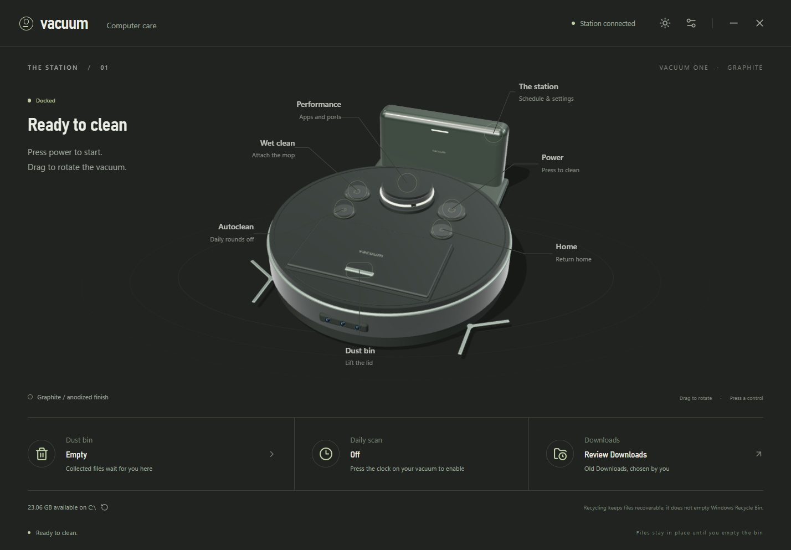
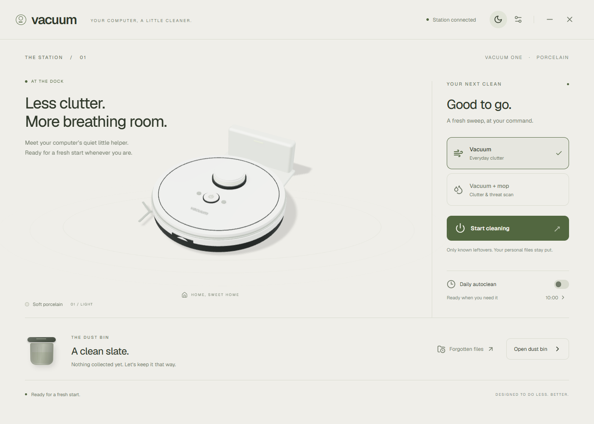

# vacuum

A Windows cleaner with a working 3D robot, a system-tray dock, and a small taskbar companion that moves while files are scanned.



## Development audit

The active quality work is documented in [quality-audit.md](docs/quality-audit.md). Development includes an optional reversible NTFS compression pass for selected bin files, measured disk free-space readouts, and continuous material transitions that preserve the 3D camera. Stable 0.2 installers below predate these development changes. Compression is not automatic. Normal Undo, integrity checks and interrupted-process recovery have passed native verification; the remaining release gates are listed in the audit.

Reproducible native checks: `node scripts/verify-storage.cjs`, `node scripts/verify-compaction.cjs`, and `node scripts/verify-animation.cjs`, `node scripts/verify-browser-cache.cjs`, and `node scripts/verify-scheduling.cjs`. They use isolated synthetic fixtures. Storage/compaction fixtures are retained rather than permanently removed. The animation-only harness is separate from real cleanup and does not prolong a scan.

## Use it

Install **Vacuum Setup 0.2.0.exe** from the private repository's Releases page, or run `release/win-unpacked/Vacuum.exe` from a local build. Closing the station leaves Vacuum in the tray; right-click its tray icon to quit.

- Press the **power button on the 3D robot** to collect known leftovers into its dust bin.
- Open the bin to review individual files. **Empty selected** asks for confirmation and sends those files to Windows Recycle Bin. Scanning itself never moves files, and the bin never empties automatically.
- Press the **droplet button on the robot** to attach the mop. Wet cleaning adds Microsoft Defender scans of temporary files and Downloads, with a blue companion trail. The result distinguishes completion, cancellation, and an unavailable/unsuccessful scan. Open Windows Security from the result for further action.
- **Forgotten files** suggests Downloads unchanged for 180 days. Select only files you no longer need. They require explicit collection and a separate empty-bin action.
- Enable **Daily autoclean**, choose a local time, and enable **Start with Windows** to keep the routine running. Vacuum checks every 30 seconds while in the tray and catches up a missed daily round after launch or resume. It does not wake a shut-down computer. Automatic rounds fill the bin; they never empty it. Both automation and login startup are off on first launch.
- Switch themes for a graphite or porcelain robot. Disable the desktop companion in Settings if you prefer the tray alone. The small companion follows looping passes and rounded U-turns in free taskbar space left of the actual Start button. Its transparent window passes all clicks through. If there is no safe space left of Start, it uses a small fallback lane just above the taskbar.



## The robot is the interface

Drag around the model to inspect it. Its power button starts a round; the home button or the dock recalls it. Press the front hatch to open the dust cassette and review or empty it. The droplet button attaches the mop, and the clock enables daily rounds. Departure, working, hatch opening, cassette emptying and docking have separate physical animations. Scan counters come from the actual file walk. Wet-mode changes keep the existing 3D scene and camera.

## What gets collected

Original, narrow allowlisted rules:

| Location                                  | Rule                                                                                                                |
| ----------------------------------------- | ------------------------------------------------------------------------------------------------------------------- |
| Current user's temporary directory        | `.tmp`, `.temp`, `.log`, unchanged for more than seven days                                                         |
| Current user's `AppData/Local/CrashDumps` | `.dmp`, unchanged for more than 30 days                                                                             |
| Chrome / Edge standard profile caches     | Network `Cache/Cache_Data` and `Code Cache/js` / `wasm`, unchanged for more than seven days; browser must be closed |
| Downloads, review only                    | Ordinary files unchanged for more than 180 days                                                                     |

Personal usefulness cannot be inferred from file age. Automatic rounds do not touch Desktop, Documents, photos, backups, registry, browser cookies, logins, sessions, extensions, site storage, application dependencies, Windows servicing files, or Recycle Bin contents.

Only standard `Default` and `Profile N` Chrome/Edge profiles under the current user's Local AppData are recognized. Custom, guest and other browser locations are excluded. Windows process detection protects each browser independently; unavailable detection protects its caches. The guard is checked again before recycling or compression, so reopening the browser after collection blocks that action. Process snapshots have a short 500 ms lifetime; the normal OS check-to-use race remains. Cache files are kept in place until explicit recycling.

Each traversal is capped at 50,000 entries. Partial coverage and unreadable locations are reported. The bin is a persisted list of references, so its byte count is potential cleanup, **not space already reclaimed**. Emptying rechecks root containment, ancestors, links, file identity, size and timestamps. Changed or inaccessible files stay in the bin. Recycling failure has no permanent-delete fallback. Electron's path-based Recycle Bin API still has a small check-to-use race; this is not a file-handle-atomic operation.

Wet mode uses the installed Defender CLI with a custom scan and `-DisableRemediation`. It does not change real-time protection, download antivirus signatures, or implement its own malware engine. Exit code 2 can mean a detection or a scan error and is reported as needing attention. Successful scans cover only the stated locations; they do not certify the whole computer. Defender may require permissions or be unavailable with another antivirus provider.

## Build and verify

Windows 10/11 x64; Node.js 22.12+ and npm.

```powershell
npm ci
node scripts/icon.cjs
npm start
```

```powershell
npm test             # Fixture-only engine, scheduler and scan-result tests
npm run build
npm run test:ui      # Native Electron integration, real WebGL and Recycle Bin
npm run pack         # Unpacked Windows app
npm run dist         # NSIS installer
```

The UI integration test uses an isolated temporary directory and recycles **only a synthetic disposable fixture**. It does not clean user folders. A separate test profile prevents login startup or scheduled cleaning from being changed. Native testing requires an interactive Windows desktop.

`npm run dev` serves a clearly labelled browser preview. It cannot access or clean local files; use the Electron app for native features. The source uses React, Three.js and Electron with a sandboxed renderer, context isolation, a narrow preload API, blocked external navigation and a Content Security Policy. No telemetry, uploads or remote cleaning rules.

## REA research

[Research findings](research/findings.md) document actual REA static inspections of shipped FluentCleaner Classic 26.09.01 assemblies and the BleachBit 6.0.6 portable package. The report includes SHA-256 identities, Evidence IDs, observed call edges, inferences, limits, and reproduction commands. Neither downloaded cleaner was executed. No third-party cleaning database or implementation was incorporated.

## State and recovery

Settings, the reference bin and the most recent round are stored under Electron's per-user application-data directory (`settings.json`, `bin.json`, `history.json`). If bin metadata is corrupt, Vacuum reports the error and refuses to clean through that manifest. Quit Vacuum, preserve a copy of `bin.json`, and rename it to start a fresh reference list; this does not touch the referenced files. Recycle Bin restoration uses Windows Explorer.

Reversible compression writes a flushed recovery journal before Windows changes file allocation. After an interrupted pass, Vacuum verifies the file identity and SHA-256 before restoring its Undo state. Files that cannot be verified remain protected in the bin with a reason; a pending inspection can be retried from the bin. Recovery never modifies file contents. `node scripts/verify-compression-recovery.cjs` verifies this using an actual interrupted child process and a retained synthetic fixture.

This is an unsigned initial Windows release. The source and installer are private. The interface uses Windows Bahnschrift and Segoe UI Variable. Library notices are included with the app.
