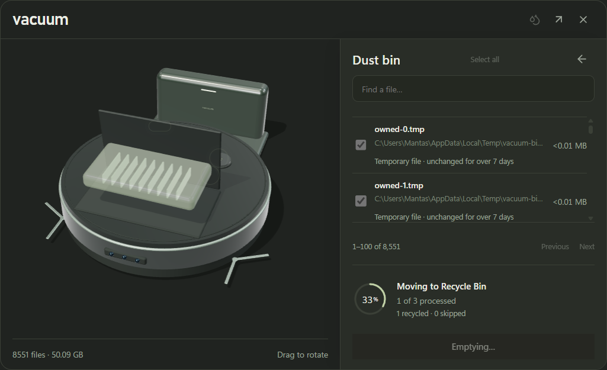
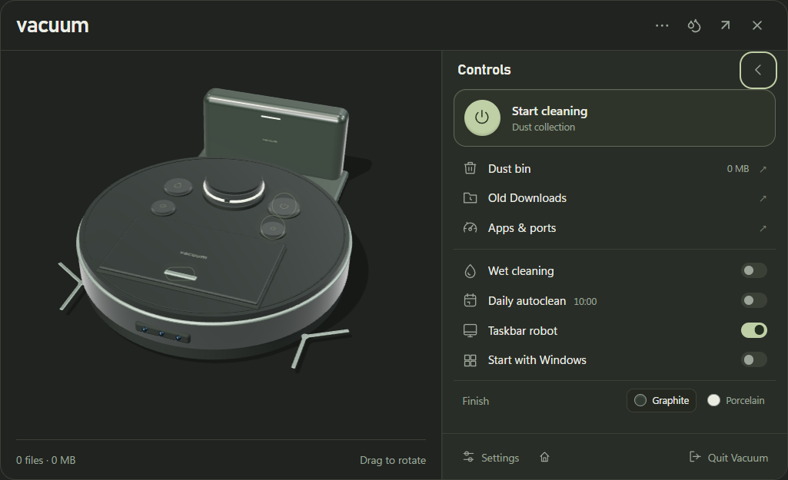
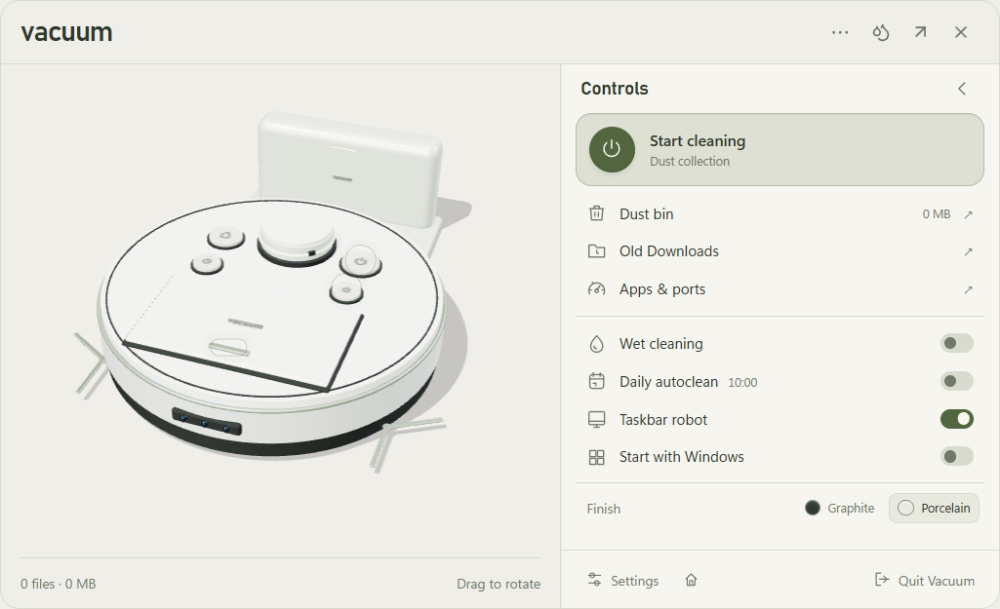

# System tray robot — 0.3.4

Click the Vacuum icon beside the Windows clock for a 440 × 500 DIP popup containing the actual Three.js robot. Opening its bin expands the flyout to at most 820 × 500 DIP, with the complete robot on the left and file review on the right. Only the file list scrolls: pagination, confirmation and empty-bin controls remain visible. Smaller monitors clamp the flyout to their work area and the camera adjusts to fit the model. Windows may place the icon under the hidden-icons arrow. The popup hides on blur, Escape or its close button. Right-click opens a custom control panel beside the full robot, using the same bounded expansion as the bin. The three-dot header button opens it too. Escape closes the panel and returns focus to that button; another Escape hides the popup. Double-click opens/restores the full station.

Power, home and the dust hatch are interactive controls on the robot. Scanning and recall use the existing native engine while the main station remains hidden. The popup's bin supports selecting files and confirming Windows Recycle Bin transfer without opening the large window. Both themes retain the same canvas, and the small dot-and-Cleaning badge was removed from the main view. Wet cleaning and the full-station shortcut are available in the popup header. The control panel contains a recessed power button, review shortcuts, mode switches, Graphite/Porcelain finishes and a pinned Settings/station/Quit footer. It follows the shared light or dark theme and reduced-motion preference. Busy actions are checked again in the main process before dispatch.

During emptying, an animated progress ring shows actual processed/selected counts, with recycled and skipped counts kept separate. A file is reported recycled after its native transfer and durable bin update. Progress messages are small and throttled, with a trailing update for a slow next file. A short result receipt follows; only skipped files remain selected. The main station also reserves space for the entire model beside every panel and pins its bin actions.

Validation includes 77 tests and `node scripts/verify-bin-progress.cjs`. Its 8,551-reference synthetic bin verifies pinned actions after 25 pages and list scrolling, non-overlapping robot/panel viewports, and real intermediate progress while owned fixture transfers are held. Two fixtures are recycled, one externally changed fixture is preserved, and the progress result counts all three correctly. Synthetic reference sizes in screenshots are not real reclaimed space. Existing tray-robot, full UI, keyboard and lifecycle checks cover the surrounding flows. Portable results are in `bin-layout-progress-proof.json`, `tray-robot-proof.json` and `tray-proof.json`. The custom tray check (`node scripts/verify-tray.cjs`) covers native right-click, both themes, switch persistence, real fixture scanning and recall, local bin review, station routes, keyboard reopening, reduced motion, invalid/disabled commands and normal Quit. No personal file is permanently removed.

